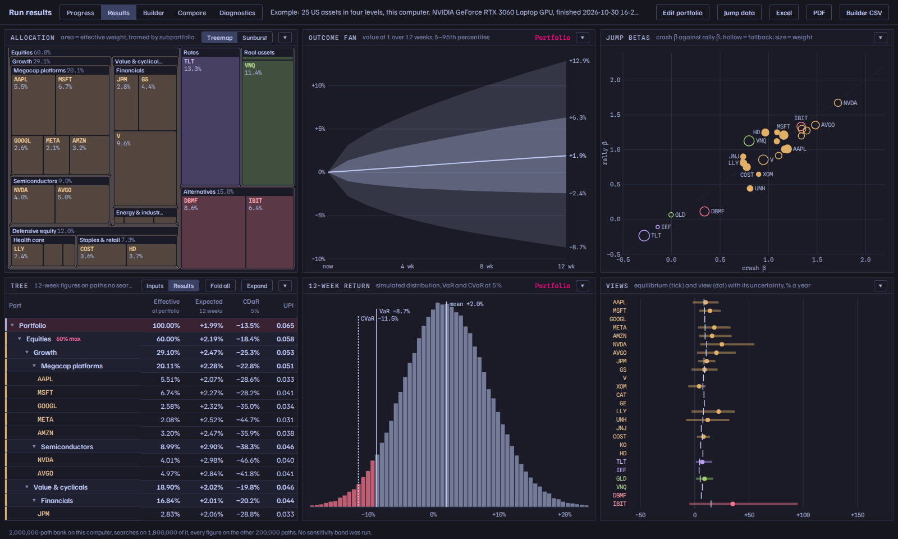
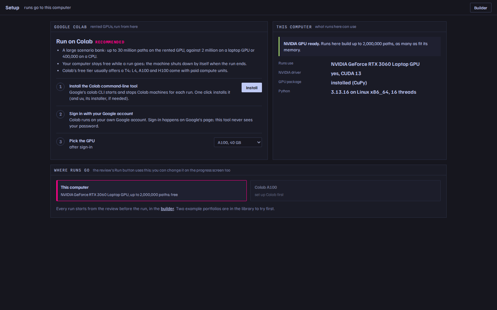
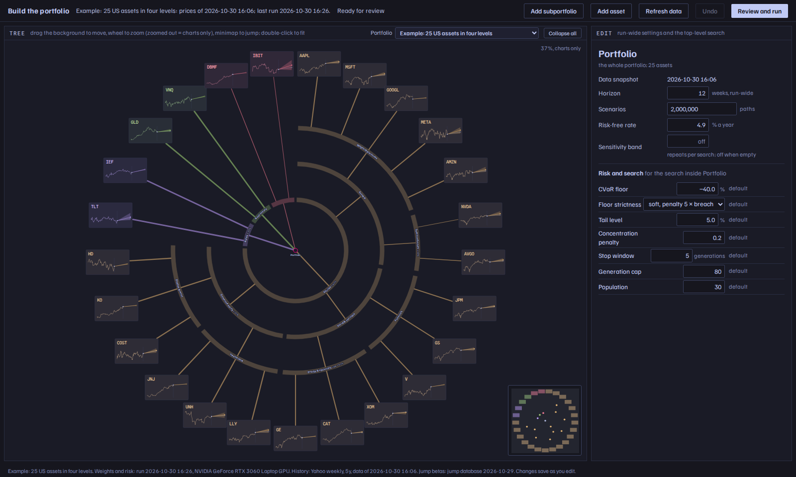
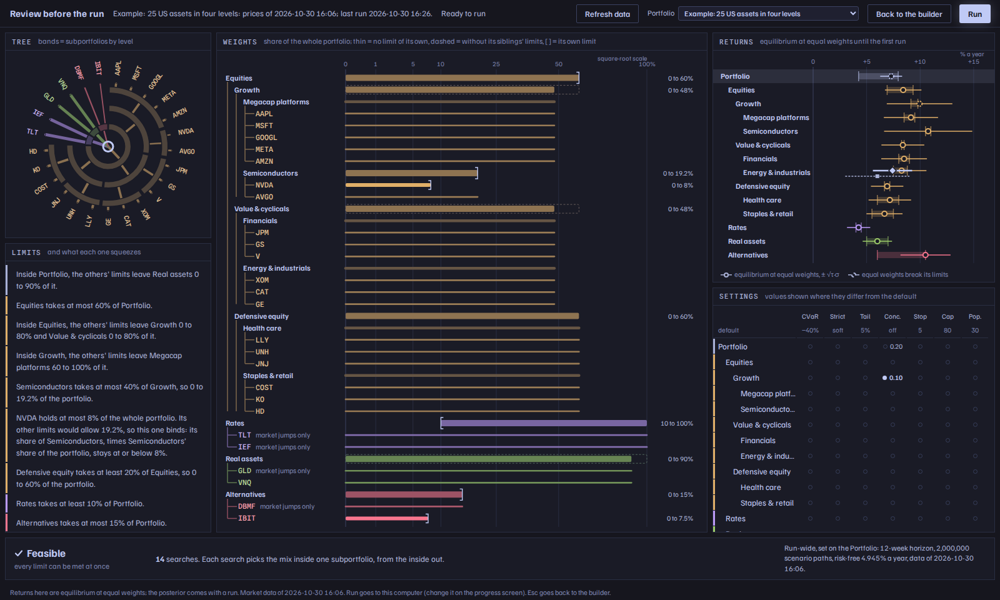
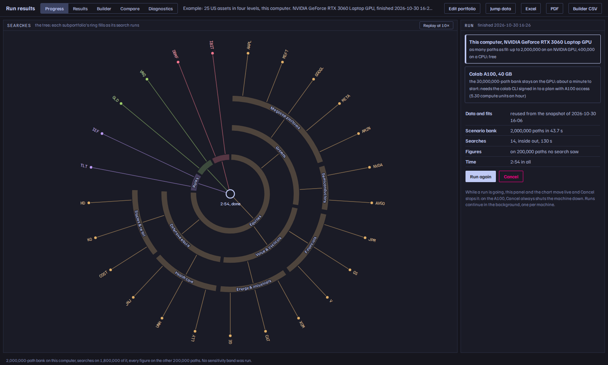
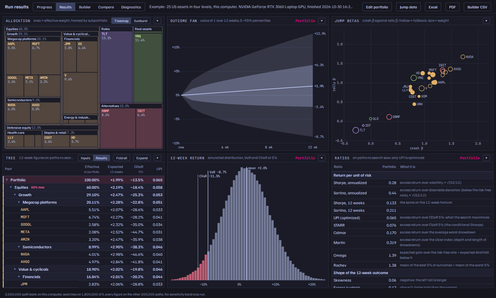
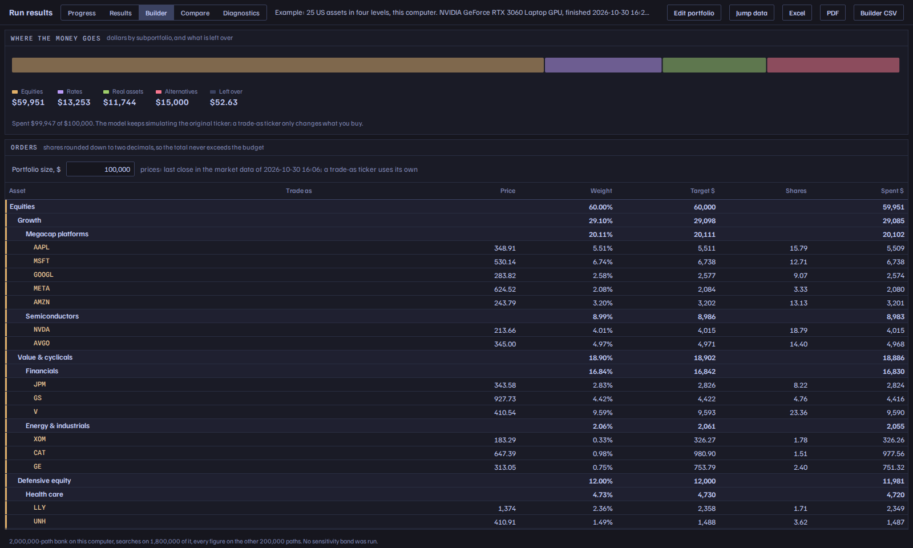
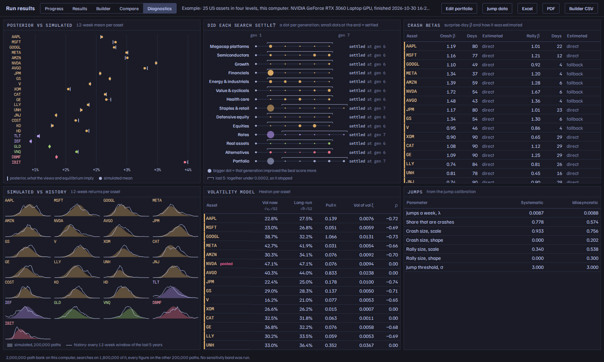

# Roptimizer

A jump-sensitive portfolio optimizer. It simulates every asset together, with stochastic volatility, self-exciting jumps and each asset's own crash and rally response to the market, and it chooses weights for the best return per unit of drawdown risk (UPI on CDaR), with Black-Litterman views on top of equilibrium returns.

A portfolio is a **tree**. Groups of assets (subportfolios) are optimized on their own, frozen, and treated as single assets by the level above, each level with its own limits, settings and views. Every candidate is scored on a **scenario bank** simulated once per run, on your NVIDIA GPU, your CPU, or a rented Google Colab GPU. Everything runs from a browser: build the tree, review it, watch the run, read the results, export them.



> The portfolios and views in this repository are example inputs used to develop and test the optimizer. They are not investment recommendations.

## Start

**macOS:** double-click `start.command`. The first time, macOS may refuse a downloaded script: right-click it, choose *Open*, then *Open* again. (Or in Terminal: `bash start.sh` in the folder.)
**Linux:** run `./start.sh` (or double-click it and choose *Run in terminal*).
**Windows:** double-click `start.bat` (checked on Windows 11: the first start installs in about 6 minutes, later starts take seconds).

The first start installs everything into the project folder: [uv](https://docs.astral.sh/uv/) (a Python installer) if you don't have it, Python 3.13, the packages, and the GPU package when an NVIDIA GPU is found. Then it opens the tool in your browser at http://localhost:8797. Later starts skip the installing. On the first visit you land on the setup screen:



- **Google Colab (recommended).** Runs go to a GPU rented from Colab: up to 30 million scenario paths, and your computer stays free. The setup screen installs Google's `colab` command-line tool, signs you in with your Google account (on Google's page; the tool never sees your password), and lets you pick the GPU: a T4 is usually in Colab's free tier; L4, A100 and H100 use paid compute units.
- **This computer.** With an NVIDIA GPU, runs build up to 2 million paths, as many as fit its memory. Without one they run on the CPU with a 400,000-path bank: slower, but the answer is as good (see *Measured*).

Two example portfolios are in the library from the start: 25 US assets in four levels, and 16 assets flat.

<details><summary>Installing by hand instead</summary>

```bash
git clone https://github.com/ElRroRo/Roptimizer && cd Roptimizer
uv venv -p 3.13 .venv && uv pip install -p .venv/bin/python -r requirements.txt
uv pip install -p .venv/bin/python "cupy-cuda12x[ctk]"   # optional, NVIDIA GPU (cupy-cuda13x[ctk] for a CUDA 13 driver)
.venv/bin/python -m app.server                            # then open http://localhost:8797
uv tool install google-colab-cli && colab sessions        # optional, Colab: installs the CLI and signs in
```

`MSO_PORT` changes the port; `MSO_DEVICE=cpu` makes runs use the CPU even with a GPU.
</details>

## Using it

1. **Build.** Pick a portfolio from the library, arrange assets into subportfolios on the radial map, and set limits, settings and views in the editor. A view is a target price or an annual return, with a − / + uncertainty of your own (lopsided ranges are fine). Everything saves as you edit; *Refresh data* downloads the day's prices again.

   

2. **Review and run.** The review shows every limit and what it squeezes, every setting and where it comes from, and anything that blocks the run. *Run* sends the frozen tree to the machine chosen on the setup or progress screen.

   

3. **Follow it.** Each subportfolio's ring fills as its search runs, from the inside out. *Cancel* stops the run; on Colab it also shuts the machine down.

   

4. **Read the results.** The analysis room shows the tree with each part's 12-week figures, the outcome fan, return and drawdown distributions, jump betas and views; any slot can show another panel, including the evaluation ratios (Sharpe, Sortino, STARR, Calmar, Martin, Omega, Rachev and the tail's shape). The other tabs: *Builder* (shares to buy for a portfolio size, with trade-as tickers), *Compare* (against an earlier run), *Diagnostics* (posterior against simulated means, convergence, simulated against historical returns, the volatility and jump models) and *Jump data* (the calibration pool, its versions and each asset's betas, with overrides). Exports: Excel, PDF and a builder CSV.

   | Ratios | Shares to buy | Diagnostics |
   |---|---|---|
   |  |  |  |

**From the command line** (the same engine):

```bash
.venv/bin/python -m mso run --csv portfolio_data.csv --out result.json                    # flat, this computer
.venv/bin/python -m mso run --portfolio my_tree.json --machine a100 --colab-gpu T4 --out r.json   # a tree on Colab
.venv/bin/python -m mso jumpdb recalibrate      # a new dated jump database version (about 70 s)
.venv/bin/python -m mso betas NVDA BTC=F        # crash and rally betas and where each came from
.venv/bin/python -m mso data refresh            # download the day's market data again
```

## How a run works

The full method, with the mathematics, is in the paper: [`paper/main.pdf`](paper/main.pdf). In short:

- **Inputs, frozen when the run starts.**
  - Weekly prices for 5 years from Yahoo Finance, in a day-keyed cache: the second run of a day downloads nothing.
  - GARCH or GJR volatility per asset (GJR where a likelihood-ratio test finds asymmetry; an asset with no response to shocks is held at constant variance). DCC correlations, fitted on the assets with at least 80% of the longest history; Heston variance with a VIX tilt.
  - Black-Litterman posterior returns from your equilibrium returns and views; lopsided ranges are converted with split-normal moments.
- **Jumps.** A dated jump database calibrates market and single-stock jumps over a 406-ticker pool (`jumpdb/<date>/`, editable on *Jump data*). Each asset's crash and rally betas come from daily S&P 500 surprise days; systematic jumps hit each asset at its beta times the S&P's volatility, and crashes also raise each asset's own variance. An asset can be set to take market jumps only (funds, bonds, indexes).
- **The scenario bank.** Simulated once per run: 30 million paths on a Colab A100, up to 2 million on a laptop GPU, 400,000 on a CPU, always sized to fit the memory. A tenth is held out: every reported figure comes from paths no search saw.
- **The search.** A differential-evolution loop scored on a fresh draw of the bank every generation, with survivors re-scored so a lucky draw cannot carry a candidate. Limits are enforced by projection; a search stops when its best score gains less than 0.0002 over 5 generations, or at 80. The tree is searched from the inside out, so a frozen subportfolio is one asset to its parent; the concentration penalty applies once, at the top, on effective weights.

## Measured

| | Laptop RTX 3060 (6 GB) | Colab A100 40 GB | Laptop CPU (16 threads) |
|---|---|---|---|
| Scenario bank | 2M paths in 5.6–8.2 s | 30M paths in 9.5–22 s | 400k paths in 21 s |
| One generation of a flat 16-asset search | 6.0 s at 1M-path draws | 6.0 s at 3M-path draws | 26–71 s at 200k-path draws |
| The 16-asset reference portfolio, from frozen inputs to results | 114 s | | 15.7 min |
| The 25-asset example tree (14 searches), from the Run button | 2 min 54 s | | |

The CPU times were taken while other work shared the machine, so they are on the slow side. A plain A100 bills 5.30 compute units an hour.

**Quality check.** The reference inputs (`benchmarks/reference/`) run flat must score at least as well as the previous version's answer, −0.08833 (lower is better). Scored on the same fresh 5 × 2,000,000 simulated paths, the laptop GPU's answer gives −0.08976 and the CPU's −0.08991: the CPU's smaller bank costs time, not quality. The evidence for every build step is in `benchmarks/results/`.

## Layout

- `mso/`: the engine. `pipeline` builds the inputs (`fits`, `bl`, `views`, `betas`, `jumpdb`, `cache`); `sim` simulates, `bank` builds the scenario bank, `search` and `tree` optimize, `report` measures the held-out figures; `xp` picks the GPU or the CPU; `job` and `colab` run on Colab; `cli` is the command line.
- `app/`: the server (FastAPI) and the screens (`static/`). `library` keeps portfolios and runs as plain files in `library/`; `runner` runs the local, Colab and data lanes; `setup` is the setup screen's API; `exports` writes the workbook, the report and the CSV; `charts/` holds pluggable result panels, and `extensions/` optional add-ons that can add routes and buttons.
- `examples/`: the example portfolios a new library starts with.
- `jumpdb/`: the dated jump-database versions and the editable pool.
- `paper/`: the paper (LaTeX source and PDF). `GLOSSARY.md` fixes the vocabulary.
- `benchmarks/`: the frozen reference inputs and answer, and the checks and their results.

## License

Apache License 2.0: see [LICENSE](LICENSE) and [NOTICE](NOTICE). © 2026 Eljon Rrodhe.

Nothing here is investment advice. The model's figures are simulations under its assumptions, not forecasts.
